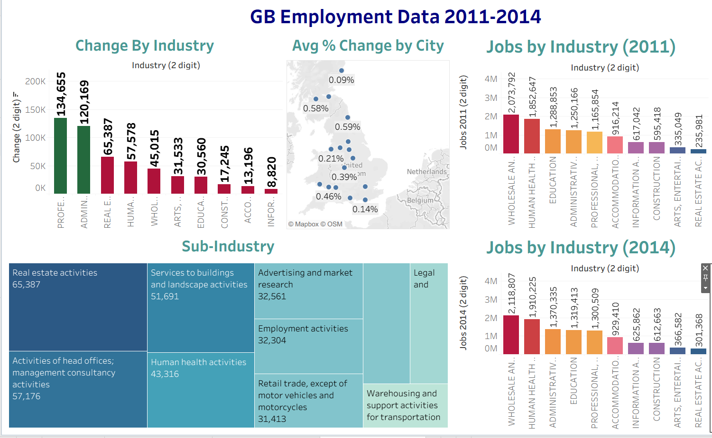
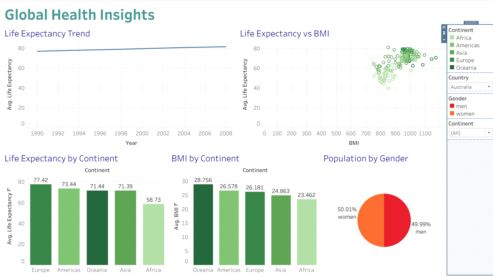
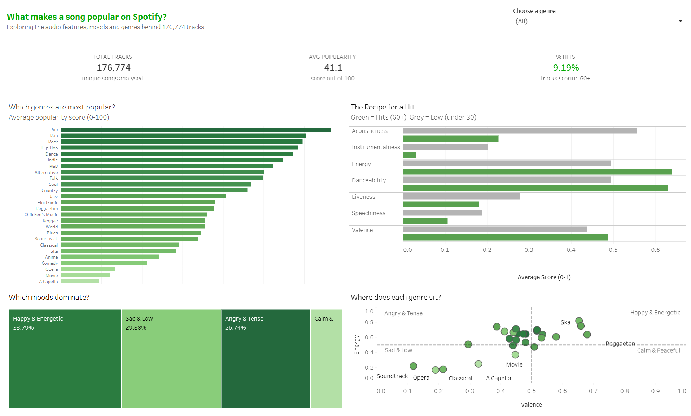

# 📊 Tableau dashboards: GB jobs, global health and Spotify

Three interactive dashboards on Tableau Public, each answering one question from a different dataset, plus a comparison of Tableau's products.

## 🔎 At a glance

| | |
|---|---|
| **Tools** | Tableau Desktop Public Edition and Tableau Public: calculated fields, Top N, range and dropdown filters, dashboard filter actions, table calculations and groups |
| **Charts** | Bar charts, a line chart, a pie chart, scatter plots, a map, treemaps and headline figures |
| **Datasets** | EMSI job change data for 16 city areas in Great Britain (2011 and 2014); Gapminder health data (158 countries, 1990 to 2008); Spotify audio features (176,774 unique tracks) |
| **Bootcamp week** | Week 2, Days 1 and 2 (September 2026), Level 3 Data Technician Skills Bootcamp, Leep Talent |
| **Type** | Individual work on training datasets |
| **Live dashboards** | [GB Employment Data](https://public.tableau.com/app/profile/isobel.hannington/viz/GBEmploymentData_17900040228790/GBEmploymentData) · [Global Health Insights](https://public.tableau.com/app/profile/isobel.hannington/viz/GlobalHealthInsights_17900762145110/GlobalHealthInsights) · [What makes a song popular on Spotify?](https://public.tableau.com/app/profile/isobel.hannington/viz/Week2SpotifyData/WhatmakesasongpopularonSpotify) |

## 🎯 Objective

- **GB Employment:** which industries and cities gained jobs between 2011 and 2014?
- **Global Health Insights:** for a health organisation, how do life expectancy and BMI vary by continent and country, and how has life expectancy changed?
- **Spotify:** an open brief. I asked what separates popular tracks from unpopular ones.

## 🗂️ Data

| Dataset | What it contains | Fields I used |
|---|---|---|
| EMSI job change (supplied by Leep Talent, included here) | 16 city areas in England, Scotland and Wales, with jobs in 2011 and 2014 for 19 industry sections and about 83 sub-industries per city | City, industry section, sub-industry, Jobs 2011, Jobs 2014, Change |
| Gapminder health (supplied by Leep Talent) | 6,004 rows: 158 countries from 1990 to 2008, with separate figures for men and women | Continent, Country, Year, Gender, Life Expectancy, BMI, Population |
| Spotify audio features (supplied by Leep Talent) | 176,774 unique tracks across 26 genres | genre, track_id, popularity, acousticness, instrumentalness, energy, danceability, liveness, speechiness, valence |

The EMSI file covers 16 city areas rather than the whole of Great Britain, so its totals describe those areas only.

## 🛠️ Approach

Each dashboard is built around one question, so a reader can follow it from the headline charts down to the detail.

**GB Employment.** Bar charts of job change and job totals by industry, a map of the 16 city areas and a treemap of sub-industries. A calculated field gives each city's growth as total change divided by 2011 jobs. The charts work as filters: clicking a city or an industry filters the rest of the dashboard.

**Global Health.** The brief's four charts: a bar chart of life expectancy by continent in 2008, a line chart of the trend for the five countries with the highest average life expectancy (one at a time, through a country dropdown), a pie chart of population by gender, and a scatter plot of average life expectancy against average BMI by country. I added a bar chart of BMI by continent as my own choice. Dropdown filters for continent and country update the charts together.

**Spotify.** Calculated fields split tracks into Hit (popularity 60+), Mid (30 to 59) and Low (under 30), and give the share of hits by distinct track. I merged two spellings of "Children's Music" (straight and curly apostrophe) into one genre. The dashboard opens with three headline figures, then each chart answers a question in its title: a bar chart of popularity by genre, a bar chart comparing the audio features of hits and low-popularity tracks, a treemap of moods, and a scatter plot placing each genre by energy and valence. A genre dropdown filters the whole dashboard.

```
Popularity Tier:
IF [popularity] >= 60 THEN "Hit"
ELSEIF [popularity] >= 30 THEN "Mid"
ELSE "Low"
END

% Hits:
COUNTD(IF [Popularity Tier] = "Hit" THEN [track_id] END) / COUNTD([track_id])
```

## 💡 Skills used

**Technical**
- Calculated fields: popularity tiers, share of hits (`COUNTD`) and a weighted growth rate
- Interactive dashboards: Top N, range and dropdown filters, and filter actions between charts
- Choosing a chart for each question: bar charts to compare, a line chart for change over time, a pie chart for a two-way split, scatter plots for relationships, a map for places and treemaps for parts of a whole
- A percentage-of-total table calculation, and a group to merge a duplicate category

**Transferable**
- Data storytelling: turning an open brief into one clear question (Spotify), with headline figures first and chart titles that ask the question each chart answers
- Writing findings for a non-technical reader (see the NHS note below)
- Reviewing my published work against the source data and correcting it

## 📈 Results and findings

### 🏢 GB Employment



- Across the 16 city areas, jobs rose by 443,276 (3.2%) between 2011 and 2014.
- Professional, scientific and technical activities added the most jobs (134,655), then administrative and support services (120,169) and real estate (65,387).
- Top sub-industries: real estate activities (65,387), head offices and management consultancy (57,176) and services to buildings (51,691).
- London grew fastest (+8.7%), followed by Brighton (+4.4%) and Nottingham-Derby (+3.1%). Four areas lost jobs: Glasgow (-2.2%), Cardiff-Newport (-0.8%), Leeds-Bradford (-0.7%) and Newcastle-Sunderland (-0.3%).

### 🌍 Global Health Insights



- In 2008, average life expectancy ranged from 77.42 years in Europe to 58.73 in Africa (Americas 73.44, Oceania 71.44, Asia 71.39). Each country counts equally; the averages aren't weighted by population.
- Average BMI was highest in Oceania (28.76) and lowest in Africa (23.46).
- Australia's life expectancy rose from 77.0 in 1990 to 81.6 in 2008.
- For the NHS: track average BMI in the UK alongside life expectancy, compare it with the rest of Europe, and look at BMI against cholesterol.

### 🎵 What makes a song popular on Spotify?



- 9.19% of tracks are hits (popularity 60+), and the average popularity score is 41.1.
- Hits are far less acoustic (0.23 against 0.56 for low-popularity tracks) and rarely instrumental (0.04 against 0.20), so polished, vocal-led production is the clearest difference.
- Pop, Rap and Rock are the most popular genres, and A Capella, Movie and Opera the least. Those three sit in the low-energy, low-valence corner, but energy alone doesn't explain popularity: Ska is among the most energetic, upbeat genres yet ranks in the bottom six.
- By mood, 33.79% of tracks are Happy and Energetic, 29.88% Sad and Low and 26.74% Angry and Tense.

## 🧾 Tableau products compared

| Product | What it is | Cost and limits |
|---|---|---|
| Tableau Desktop Public Edition | Free authoring app | Everything is published publicly to Tableau Public; fewer data connectors |
| Tableau Desktop (Creator licence) | Full authoring app | Paid; connects to a much wider range of sources |
| Tableau Prep Builder | Cleans and reshapes data before analysis | Included in the paid Creator licence; scheduling flows with Prep Conductor needs a paid Server or Cloud set-up |
| Tableau Server | Self-hosted platform for sharing and collaboration | Hosted and maintained by the organisation itself |
| Tableau Cloud | Salesforce-hosted platform | Ongoing subscription; Tableau Pulse (AI summaries of metrics) is included in every edition |
| Tableau+ | Premium Tableau Cloud edition | Adds premium AI features, such as Tableau Agent in Pulse |

Tableau Public's main limit is that everything published is public, so it suits open or sample data only.

## 🧠 Challenges and what I learned

- **Sum or average?** BMI has to be averaged. Summing it added 38 rows per country (19 years, men and women) and pushed the axis to about 1,100.
- **Don't average percentages.** Averaging sub-industry growth rates let tiny sub-industries dominate (one in London went from 6 jobs to 535) and made Glasgow look as if it was growing when it lost jobs. Total change over total 2011 jobs gives the true rate.
- **Check what a filter hides.** A Top 10 filter on job growth leaves large employers that shrank, such as manufacturing, off the job-total charts, so their titles now say so.
- **Clean categories before grouping.** Two spellings of one genre would have split it across two bars.

## 💼 Where this applies

A sum of a rate or an average of percentages can look plausible and still be wrong. Spotting that is how an auditor tests a reported number. For analyst roles, the dashboards show I can turn a raw extract into something a manager can use unaided.

## 📁 Repository contents

| File | What it contains |
|---|---|
| `GB_Employment_Data.twbx` | The GB Employment dashboard as a packaged Tableau workbook |
| `Global_Health_Insights.twbx` | The Global Health Insights dashboard as a packaged Tableau workbook |
| `Spotify_Data.twbx` | The Spotify dashboard as a packaged Tableau workbook, with its data inside |
| `EMSI_JobChange_UK.xlsx` | The UK employment dataset behind the GB Employment dashboard |
| `GapminderHealth_Dataset.xlsx` | The Gapminder health dataset behind the Global Health Insights dashboard |
| `Data_Technician_Workbook_Week_2.docx` | The Leep Talent Week 2 workbook with my written answers (Days 1 and 2 cover this project) |
| [`images/`](images/) | Screenshots of the three dashboards |

Each `.twbx` file opens in Tableau Desktop or the free Tableau Public app. The live dashboards are on Tableau Public, at the links at the top of this page.
